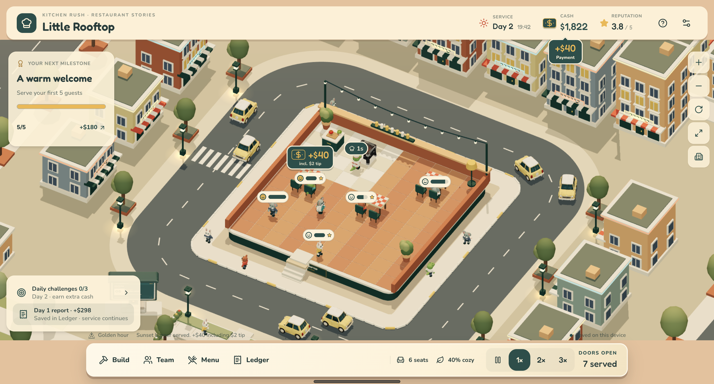

# Kitchen Rush — Rooftop Restaurant Tycoon

A cozy 3D restaurant management sim that runs in your browser. Build a sunset rooftop bistro on a grid, hire and train an autonomous animal crew, set your menu prices and watch real guests arrive, order, eat, tip and leave. Then reinvest the profit, one service day at a time.

Built with **React 19**, **React Three Fiber**, **Three.js**, **TypeScript** and **Vite**. No backend, no accounts. All progress is saved locally in the browser.

<p align="center">
  
</p>

> Every number in the game comes from a deterministic simulation: revenue, tips, wages, guest counts, ratings and offline earnings. The game never shows estimated or made-up figures.

---

## Table of contents

- [Features](#features)
- [How to play](#how-to-play)
- [Quick start](#quick-start)
- [Scripts](#scripts)
- [Project structure](#project-structure)
- [Architecture](#architecture)
- [Game rules and economy](#game-rules-and-economy)
- [Testing](#testing)
- [Accessibility](#accessibility)
- [Assets](#assets)
- [Contributing](#contributing)
- [Roadmap ideas](#roadmap-ideas)
- [License](#license)

---

## Features

### Build and decorate
- **Grid-based construction** on a 10×10 rooftop, expandable to 14×10 with the east terrace.
- **Interiors shop** with Dining, Decor and Kitchen categories, real prices, footprints, benefits and owned-item counts.
- **Preview before you buy:** a ghost placement with a teal/red footprint, gold alignment guides, a column/row readout and aisle validation. You only pay when you press **Confirm**.
- Moving furniture is free. Selling refunds 70% of the price.
- **Pathfinding validation:** a layout is rejected if any guest or staff route gets blocked.

### An autonomous restaurant
- Staff and guests pathfind on their own. **Chefs** cook at prep counters (salads) and grills (burgers). **Servers** deliver food and clear tables.
- Four original procedural animal species: mouse, crocodile, rabbit and bear. Rigs, faces and animation are authored in code.
- **Satisfaction meters** above every guest (teal → gold → tomato) are driven by each guest's actual patience timer.
- Pause plus 1×, 2× and 3× speed.

### Run the business
- **Team:** hire chefs or servers (up to 6). Training makes them faster and raises their daily wage.
- **Menu:** toggle dishes and set prices. Charging more than the fair price drives some guests away.
- **Continuous days:** service rolls into the next day automatically, and each day saves an immutable receipt.
- **Daily receipt:** total revenue (sales + tips), ingredients, wages, rent, loan repayments, net profit, margin, guest counts, rating and change versus the previous day.
- **Ledger:**
  - a **weekly revenue chart** by 7-day game weeks
  - same-period growth comparison against the previous week
  - a day explorer that opens any of the last 20 receipts
- **Daily challenges:** three seeded goals per game day, such as gold-star guests, dish sales, fast service, revenue or tips. Rewards are paid automatically once, separate from service profit.
- **Milestones** and an interest-free **recovery loan** for struggling owners.
- **Low-capital warning:** a red banner appears when cash can't safely cover the day's closing bills. It has a one-click **Close for renovation** button that finishes current guests before closing.

### Offline progress you can trust
- When you leave, the departure time is saved. When you return, the game **replays the elapsed time at 1× through the same simulation step**, in chunks and with checkpoints.
- An explicit pause, renovation or too little startup cash stops offline work, so you never wake up to endless offline debt.
- A "While you were away" summary shows actual days completed, guests served and the cash change.

### A living city
- A miniature sunset neighborhood with shops, apartments, gardens, a water promenade and a boulevard loop.
- **Traffic:** six cars with proximity-based stereo engine audio and an occasional gentle horn.
- Animal pedestrians and a **pocket park** where visitors rest on benches.
- **Cosmetic weather:** golden hour → bright sun → light rain, with puddles and ripples.
- Street lamps turn on as the sky darkens, and neon cornices glow.
- A **digital street bulletin** showing the actual number of guests in the restaurant and real restaurant news.
- Camera views for the restaurant, the whole neighborhood and individual districts, with zoom and four rotations.

---

## How to play

1. **Make it yours:** open **Build → Interiors**, buy tables (each comes with two chairs), plants, lanterns or screens, and snap them onto the grid.
2. **Set up your team and menu:** you need a prep counter for salads and a grill for burgers. Price near the suggested value to start.
3. **Open the restaurant.** Your team takes it from there. Each day lasts about 2½ minutes at 1×, plus time to finish the remaining guests.
4. **Read the receipt** from the business-updates card or the **Ledger**. Service keeps running while you read.
5. **Reinvest:** to change furniture, staff or menu, use **Build → Close for renovation**. The restaurant stops taking guests, finishes the current ones, then stays closed until you reopen.

### Controls

| Action | Mouse / touch | Keyboard |
|---|---|---|
| Place or move furniture | Tap a grid cell | Arrow keys |
| Rotate placement | Rotate button | `R` |
| Cancel / close panel | ✕ button | `Esc` |
| Pause / resume service | Pause button | `Space` |
| Camera | Zoom, rotate, reset and neighborhood buttons | — |

---

## Quick start

### Prerequisites
- [Bun](https://bun.sh) 1.1 or newer (the project's package manager)
- A browser with WebGL 2

### Install and run

```bash
git clone <your-repo-url>
cd <repo>/web-kitchen-rush
bun install
bun run dev
```

Then open http://localhost:8080.

### Production build

```bash
bun run build      # outputs to web-kitchen-rush/dist
bun run preview    # serves the production build locally
```

The output is a static site, so it can be deployed to any static host (Netlify, Vercel, GitHub Pages, Cloudflare Pages, …). The app uses one catch-all route, so configure your host to serve `index.html` for unknown paths.

No environment variables are required.

---

## Scripts

Run these from `web-kitchen-rush/`:

| Command | Description |
|---|---|
| `bun run dev` | Vite dev server on port 8080 |
| `bun run build` | Production build |
| `bun run preview` | Preview the production build |
| `bun run lint` | ESLint |
| `bun run test` | Unit tests, then browser tests |
| `bun run test:watch` | Unit tests in watch mode |
| `bun run test:browser` | Browser tests in watch mode |
| `bun run test:browser:run` | Browser tests once |
| `bunx tsc -p tsconfig.app.json --noEmit` | Type check |

---

## Project structure

```text
web-kitchen-rush/
├── public/                 # favicon, icon, robots.txt
├── scripts/                # Playwright + WebGL end-to-end verifiers (verify-*.mjs) and scene inspectors
├── src/
│   ├── management/         # ★ The restaurant tycoon (current game)
│   │   ├── engine.ts       # Deterministic simulation: economy, pathing jobs, days, offline replay, saves
│   │   ├── types.ts        # Zod save schema, catalog, dishes, constants
│   │   ├── layout.ts       # Grid placement rules, collision and A* pathfinding
│   │   ├── ManagementGame.tsx  # Owner UI shell: header, dock, panels, dialogs
│   │   ├── RestaurantScene.tsx # R3F scene: restaurant, agents, city
│   │   ├── Panels.tsx / InteriorsPanel.tsx / DailyReport.tsx / WeeklyRevenue.tsx
│   │   ├── daily-challenges.ts, weekly-revenue.ts, capital-warning.ts, report.ts
│   │   └── City*.tsx, weather.ts, traffic-audio.ts, bulletin.ts, park-motion.ts
│   ├── scene/              # Procedural animal rigs, faces, food and station models
│   ├── game/               # Legacy arcade cooking mode + shared assets/animation helpers
│   ├── components/         # Shared UI (shadcn/ui in components/ui)
│   ├── hooks/              # useReducedMotion, useMobile
│   ├── pages/Index.tsx     # Entry → ManagementGame
│   └── test/               # Vitest unit (*.test.ts) and browser (*.browser.test.tsx) suites
├── vitest.config.ts
└── vitest.browser.config.ts
```

> **About `src/game`:** Kitchen Rush started as a local co-op arcade cooking game and was later rebuilt into a management sim. The arcade source is kept because the procedural chefs, food models and animation systems are reused, but it is not mounted from the entry page.

---

## Architecture

### Simulation is the single source of truth
`RestaurantEngine` (`src/management/engine.ts`) owns all game state and money. It advances in **fixed 0.1-second steps**, using a seeded RNG for guest arrivals, species and dish choices. Rendering never changes outcomes.

```text
requestAnimationFrame ──► engine.update(dt × speed) ──► fixed step(0.1s) × N
                                                          │
React (useSyncExternalStore) ◄── notify() ◄───────────────┘
R3F scene reads engine.state (positions, stages) every frame
```

- **Determinism:** the same seed and inputs always produce the same days. The tests use this to prove that offline replay matches live play exactly.
- **Offline catch-up:** `resume()` replays `(now - lastActiveAt) / 100ms` steps in chunks of 1,000, saves checkpoints and yields between chunks. It never credits income twice and can be cancelled by `reset()`.
- **Persistence:** a versioned save under `localStorage["kitchen-rush-restaurant-v1"]` is validated with Zod on load. Older saves migrate safely. An unreadable save is never overwritten unless you choose to.
- **Bounded history:** only the latest 20 daily receipts are kept. The weekly chart shows days that are no longer saved as "unavailable" instead of treating them as `$0`.

### UI
- Derived views stay **pure and read-only**, for example `buildRevenueWeeks`, `getCapitalWarning` and `summarizeReport`, so they are easy to unit test.
- Expensive projections are memoized against stable data such as receipt history, not against every simulation frame.
- Tailwind with a small design-token palette: cream `#FFF2D7`, ink `#233D3B`, deep teal `#224F4A`, tomato `#DC533C`, gold `#F2B743`. Fonts: Fredoka (headings) and Nunito (UI).

### 3D
- React Three Fiber with an orthographic three-quarter camera that fits the editable grid on any screen size.
- Animal characters are **procedural rigs**: named joints, two-bone IK and morph-target facial expressions. They do not use downloaded animation clips.
- City scenery uses instanced meshes and fixed particle pools. Glow is local rather than full-screen bloom, which keeps it fast on low-end GPUs.
- Ambient life (cars, walkers, weather) pauses with the game, the hidden tab, report screens and reduced-motion settings.

---

## Game rules and economy

| Item | Value |
|---|---|
| Starting cash | $1,250 |
| Day length | 150 s of service, plus time to finish remaining guests (up to 90 s) |
| Rent | $30/day ($50 once expanded) |
| Wages | Chef $34, server $26, +$12 per training level |
| Hire | $150 (max 6 staff; at least 1 chef and 1 server) |
| Training | $180 × current level (max level 3) |
| Garden salad | $7 ingredients, fair price $24, 6 s to cook, needs a prep counter |
| Sunset burger | $12 ingredients, fair price $38, 10 s to cook, needs a grill |
| Furniture | Table $180 · Prep $240 · Grill $360 · Planter $65 · Screen $80 · Lantern $110 |
| East terrace | $900, unlocks after 3 service days |
| Recovery loan | $600 at 0% when cash < $200, repaid at $30 per day |
| Opening reserve | Daily wages + rent + $30 for ingredients |

- **Net profit** = sales + tips − ingredients − wages − rent − loan repayment.
- **Challenge bonuses**, milestone rewards, loans and furniture refunds add to cash but are **not** counted as revenue or profit.
- Tips grow with atmosphere (comfort from decor) and shrink with wait time.
- A guest's patience is 48 s + 0.18 × atmosphere.

---

## Testing

The project has two Vitest suites, run together with `bun run test`:

- **Unit tests** (`src/test/*.test.ts`) cover:
  - simulation and economy
  - continuous days and an 8-hour offline replay
  - save migration
  - challenges, weekly revenue, capital warnings, pathfinding, weather, traffic audio and animation math
- **Browser tests** (`src/test/*.browser.test.tsx`) run in real Chromium through Playwright. They cover:
  - responsive layouts at 320, 390, 768 and 1280 px
  - 44 px touch targets
  - keyboard flows
  - checks that panels never overlap

  The 3D scene is mocked so these tests stay deterministic.

First-time browser setup:

```bash
bunx playwright install chromium
```

### WebGL end-to-end verifiers (optional)
`scripts/verify-*.mjs` start Vite on port 5173 and drive the **real WebGL scene** with SwiftShader. They do things like placing furniture by raycast, simulating real service days and taking screenshots. Run them one at a time:

```bash
node scripts/verify-ledger.mjs            # desktop
node scripts/verify-ledger.mjs mobile     # 390×844 touch
node scripts/verify-capital-warning.mjs no-shots
```

When a verifier finishes, an `error: "vite" exited with code 143` line is expected cleanup.

---

## Accessibility

- All controls are at least 44×44 px, with visible gold focus rings.
- Placement, camera, pause and native select controls work from the keyboard.
- `prefers-reduced-motion` is respected live: no bounce, particles or rain, static expressions and steady lights.
- Semantic regions, labelled meters and accessible chart descriptions.
- Color is never the only signal: satisfaction meters also show faces, and warnings use icons and text.

---

## Assets

- **Characters, furniture, the city, weather and lighting** are procedural and authored in this repository.
- **Some 3D models and audio were AI-generated** and are currently loaded from remote URLs listed in:
  - `src/game/assets.ts`: bulletin kiosk, park bench, knife, burger, salad, tomato, lettuce, grill, music and sound effects
  - `src/management/CityLife.tsx`: city car

  These URLs are hosted by the original project. **If you fork this project for long-term use, download those files into `public/` and update the URLs**, so your build doesn't depend on someone else's hosting.
- Fonts: [Fredoka](https://fonts.google.com/specimen/Fredoka) and [Nunito](https://fonts.google.com/specimen/Nunito) via `@fontsource` (SIL Open Font License).
- Icons: [Lucide](https://lucide.dev) (ISC).

---

## Contributing

Contributions are welcome.

1. Fork the repository and create a feature branch.
2. Keep the simulation as the source of truth. UI and rendering must not change game state or money except through engine methods.
3. Never display numbers the simulation didn't produce.
4. Add or update tests close to your change, then make sure these pass:
   ```bash
   bun run lint
   bunx tsc -p tsconfig.app.json --noEmit
   bun run test
   bun run build
   ```
5. Check the layout at phone (≈390 px) and desktop widths, with and without reduced motion.
6. Open a pull request describing the change and how you tested it. Add screenshots for UI changes.

**Conventions:** TypeScript with explicit types, Tailwind for styling, shadcn/ui primitives, lucide icons and Bun only (no npm/yarn lockfiles). The project does not use React Compiler, so use `memo`, `useMemo` and `useCallback` deliberately.

---

## Roadmap ideas

- More dishes, stations and furniture themes
- Staff traits and morale
- Cloud save and export/import of save files
- Seasonal city events derived from real gameplay
- Localization

---

## License

No license has been chosen yet. Add a `LICENSE` file before publishing. [MIT](https://choosealicense.com/licenses/mit/) is a common choice for open-source games. Note that the third-party fonts and icons keep their own licenses (see [Assets](#assets)).

---

<p align="center">Made with love, one table at a time.</p>
